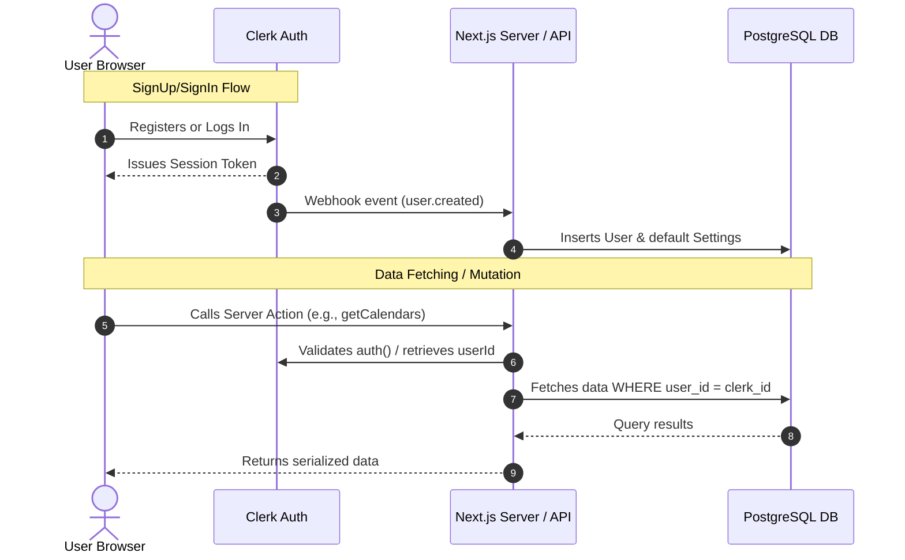
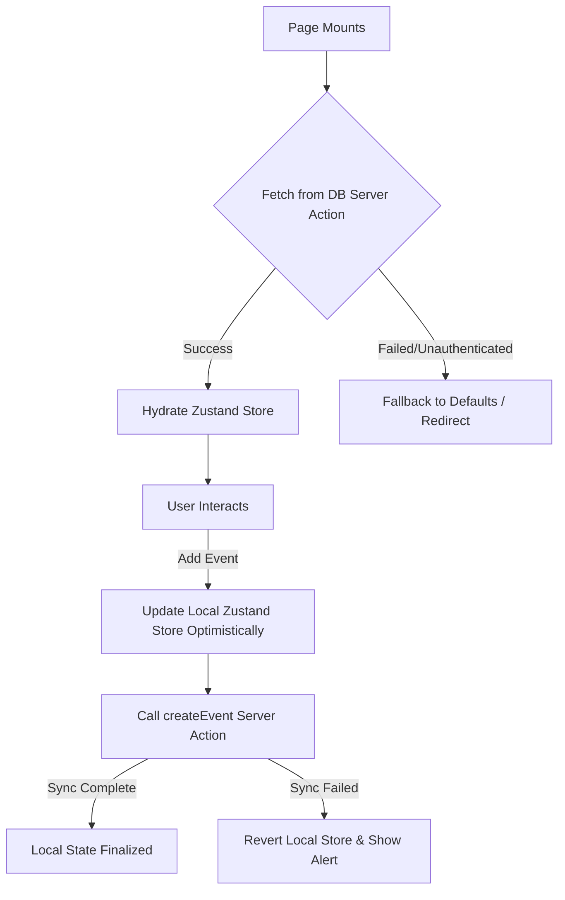

# Backend Implementation Plan: Server Actions & Clerk Sync

This document outlines the step-by-step plan to transition **Life Calendar** from a client-only localStorage application to a fully persistent, secure backend utilizing **Next.js Server Actions**, **Clerk Authentication**, and **Drizzle ORM** with **PostgreSQL**.

---

## Architectural Overview

The backend architecture consists of three core components:
1. **User Identity Sync**: A secure webhook handler (`/api/webhooks`) that listens to Clerk user events (`user.created`, `user.updated`, `user.deleted`) and mirrors user data in our PostgreSQL database.
2. **Database Schema updates**: Associating calendars, events, categories, and settings with a specific `userId` to ensure data isolation.
3. **Data Operations**: Next.js Server Actions that perform authenticated CRUD operations, validating the current user session before any query.



---

## Phase 1: Database Schema Modifications

We need to update our Drizzle schema at [schema.ts](file:///D:/code/life-calender/lib/db/schema.ts) to support multi-user isolation.

### 1. Define the `users` Table
```typescript
import { pgTable, varchar, timestamp, integer, boolean, text } from "drizzle-orm/pg-core";

export const users = pgTable("users", {
  id: varchar("id", { length: 128 }).primaryKey(), // Matches Clerk's user ID (e.g., user_2k...)
  email: varchar("email", { length: 255 }).notNull(),
  name: varchar("name", { length: 255 }),
  imageUrl: text("image_url"),
  createdAt: timestamp("created_at", { mode: "date" }).notNull().defaultNow(),
  updatedAt: timestamp("updated_at", { mode: "date" }).notNull().defaultNow(),
});

export type DbUser = typeof users.$inferSelect;
export type NewDbUser = typeof users.$inferInsert;
```

### 2. Update `calendars` and `globalSettings` Tables
We will link `calendars` to `users` and rewrite `globalSettings` so that it is keyed per-user rather than a single static row.

```typescript
export const calendars = pgTable("calendars", {
  id: varchar("id", { length: 128 }).primaryKey(),
  userId: varchar("user_id", { length: 128 })
    .notNull()
    .references(() => users.id, { onDelete: "cascade" }), // Cascade delete calendars if user is deleted
  name: varchar("name", { length: 255 }).notNull(),
  color: varchar("color", { length: 50 }).notNull(),
  birthDate: timestamp("birth_date", { mode: "date" }).notNull(),
  lifeExpectancy: integer("life_expectancy").notNull().default(90),
  isActive: boolean("is_active").notNull().default(false),
  createdAt: timestamp("created_at", { mode: "date" }).notNull().defaultNow(),
});

export const globalSettings = pgTable("global_settings", {
  userId: varchar("user_id", { length: 128 })
    .primaryKey()
    .references(() => users.id, { onDelete: "cascade" }),
  activeCalendarId: varchar("active_calendar_id", { length: 128 })
    .references(() => calendars.id, { onDelete: "set null" }),
  weekStartsOn: integer("week_starts_on").notNull().default(1), // 0 = Sunday, 1 = Monday
  showFutureWeeks: boolean("show_future_weeks").notNull().default(true),
  theme: varchar("theme", { length: 20 }).notNull().default("light"),
});
```

---

## Phase 2: Database Migration

Generate and apply the migrations to align your PostgreSQL database with the modified Drizzle schema.

1. **Generate migrations**:
   ```bash
   npm run db:generate
   ```
2. **Apply migrations**:
   ```bash
   npm run db:push
   ```
   *(Alternatively, for strict environments, run `npm run db:migrate` if standard SQL migrations are enforced).*

---

## Phase 3: Clerk Webhook Sync Setup

We will create a public webhook route to keep our local `users` table synchronized when users register, update profile info, or delete their accounts in Clerk.

### 1. Configure the Public Route in Middleware
Update [middleware.ts](file:///D:/code/life-calender/middleware.ts) to bypass authentication check on the webhook endpoint.

```typescript
// middleware.ts
import { clerkMiddleware, createRouteMatcher } from '@clerk/nextjs/server';

const isProtectedRoute = createRouteMatcher([
  '/calendar(.*)',
]);

const isPublicRoute = createRouteMatcher([
  '/api/webhooks(.*)', // Exclude webhooks from Clerk protection
]);

export default clerkMiddleware(async (auth, req) => {
  if (isProtectedRoute(req) && !isPublicRoute(req)) {
    await auth.protect();
  }
});
```

### 2. Create the Webhook API Handler
Create the webhook router at `app/api/webhooks/route.ts`. It verifies the request signature using the Clerk/Svix secret and updates the database.

> [!IMPORTANT]
> To support webhooks, you must install the `svix` package if not already present:
> ```bash
> npm install svix
> ```

```typescript
// app/api/webhooks/route.ts
import { verifyWebhook } from '@clerk/nextjs/webhooks';
import { NextRequest } from 'next/server';
import { db } from '@/lib/db';
import { users, globalSettings } from '@/lib/db/schema';
import { eq } from 'drizzle-orm';

export async function POST(req: NextRequest) {
  let evt;
  try {
    evt = await verifyWebhook(req); // Automatically uses CLERK_WEBHOOK_SIGNING_SECRET from environment
  } catch (err) {
    console.error('Webhook signature verification failed:', err);
    return new Response('Verification failed', { status: 400 });
  }

  const { type, data } = evt;

  if (type === 'user.created') {
    const { id, email_addresses, first_name, last_name, image_url } = data;
    const email = email_addresses[0]?.email_address;
    const name = `${first_name ?? ''} ${last_name ?? ''}`.trim() || 'New User';

    // 1. Sync User to Database
    await db.insert(users).values({
      id,
      email,
      name,
      imageUrl: image_url,
    });

    // 2. Initialize Default Settings for this User
    await db.insert(globalSettings).values({
      userId: id,
      weekStartsOn: 1,
      showFutureWeeks: true,
      theme: 'light',
    });
  }

  if (type === 'user.updated') {
    const { id, email_addresses, first_name, last_name, image_url } = data;
    const email = email_addresses[0]?.email_address;
    const name = `${first_name ?? ''} ${last_name ?? ''}`.trim() || 'User';

    await db.update(users)
      .set({
        email,
        name,
        imageUrl: image_url,
        updatedAt: new Date(),
      })
      .where(eq(users.id, id));
  }

  if (type === 'user.deleted') {
    const { id } = data;
    if (id) {
      // Cascading deletes will remove associated calendars, events, and settings
      await db.delete(users).where(eq(users.id, id));
    }
  }

  return new Response('Webhook handled successfully', { status: 200 });
}
```

---

## Phase 4: Next.js Server Actions

We will build the data mutation layer using Next.js Server Actions. Each action will run on the server side and verify authorization before querying.

### 1. Authenticated Helper Utilities
Create a helper to retrieve the authenticated user's ID inside Server Actions.

```typescript
// lib/actions-helper.ts
import { auth } from "@clerk/nextjs/server";

export async function getAuthenticatedUserId() {
  const { userId } = await auth();
  if (!userId) {
    throw new Error("Unauthorized: You must be logged in to perform this action.");
  }
  return userId;
}
```

### 2. Calendar Server Actions (`app/actions/calendars.ts`)
```typescript
"use server";

import { db } from "@/lib/db";
import { calendars, globalSettings } from "@/lib/db/schema";
import { getAuthenticatedUserId } from "@/lib/actions-helper";
import { eq, and } from "drizzle-orm";
import { revalidatePath } from "next/cache";

export async function getCalendars() {
  const userId = await getAuthenticatedUserId();
  return db.select().from(calendars).where(eq(calendars.userId, userId));
}

export async function createCalendar(data: {
  name: string;
  color: string;
  birthDate: Date;
  lifeExpectancy: number;
}) {
  const userId = await getAuthenticatedUserId();
  const calendarId = crypto.randomUUID();

  // Create Calendar
  await db.insert(calendars).values({
    id: calendarId,
    userId,
    name: data.name,
    color: data.color,
    birthDate: data.birthDate,
    lifeExpectancy: data.lifeExpectancy,
    isActive: true,
  });

  // Set as Active Calendar in Global Settings
  await db.update(globalSettings)
    .set({ activeCalendarId: calendarId })
    .where(eq(globalSettings.userId, userId));

  revalidatePath("/calendar");
  return { id: calendarId };
}

export async function deleteCalendar(calendarId: string) {
  const userId = await getAuthenticatedUserId();
  
  // Verify ownership before deleting
  await db.delete(calendars)
    .where(and(eq(calendars.id, calendarId), eq(calendars.userId, userId)));
    
  revalidatePath("/calendar");
}
```

### 3. Events Server Actions (`app/actions/events.ts`)
Similar Server Actions should be added to handle events (`getEvents`, `createEvent`, `updateEvent`, `deleteEvent`), ensuring validation checks are performed on ownership of the target `calendarId`.

---

## Phase 5: Client-Side Zustand Store Integration

Currently, [life-calendar-store.ts](file:///D:/code/life-calender/lib/life-calendar-store.ts) uses `persist` with `localStorage`. In a server-driven architecture, we can adopt one of two strategies:

### Option A: Read-Through Cache Strategy (Recommended)
Keep the Zustand store as a client-side state manager for smooth UI animations, zoom level, and selected week, but hydrate it from the database upon page load and sync mutations using Server Actions.



#### Implementation Steps:
1. **Remove `persist` middleware** from the persistent properties of Zustand if you want the server to be the source of truth, or keep it only for local UI settings (e.g., `zoomLevel`, `viewMode`).
2. **Create an Initializer Component** or fetch data directly inside a Server Component wrapper and pass the initial state into a client-side provider.
3. **Refactor Zustand Actions** to perform optimistic updates:
   ```typescript
   addEvent: async (eventData) => {
     const temporaryId = generateId();
     // 1. Optimistic Update on Client
     set((state) => ({
       events: [...state.events, { ...eventData, id: temporaryId }]
     }));
     
     try {
       // 2. Trigger Server Action
       const newEvent = await createEventAction(eventData);
       // 3. Update store with official database ID
       set((state) => ({
         events: state.events.map(e => e.id === temporaryId ? newEvent : e)
       }));
     } catch (error) {
       // 4. Revert state on error
       set((state) => ({
         events: state.events.filter(e => e.id !== temporaryId)
       }));
       toast.error("Failed to sync event with database");
     }
   }
   ```

---

## Phase 6: Testing & Deployment

### 1. Local Testing
To test the webhook locally:
1. Install a tunneling tool, such as **Cloudflare Tunnel** or **ngrok**:
   ```bash
   npx localtunnel --port 3000
   ```
2. Copy the tunnel URL (e.g., `https://example-tunnel.loca.lt`) and navigate to the **Clerk Dashboard -> Webhooks**.
3. Create an Endpoint pointing to `https://example-tunnel.loca.lt/api/webhooks`.
4. Subscribe to the `user.created`, `user.updated`, and `user.deleted` events.
5. In your local `.env.local` file, add the signing secret:
   ```env
   CLERK_WEBHOOK_SIGNING_SECRET=whsec_...
   ```

### 2. Cloudflare Pages/Workers Deployment
Since the project is using `@opennextjs/cloudflare` and `wrangler` for deployment:
1. Upload the database connection string and Clerk secrets as Wrangler secrets:
   ```bash
   npx wrangler secret put CLERK_SECRET_KEY
   npx wrangler secret put CLERK_WEBHOOK_SIGNING_SECRET
   npx wrangler secret put DATABASE_URL
   ```
2. Deploy the updated worker:
   ```bash
   npm run deploy
   ```
